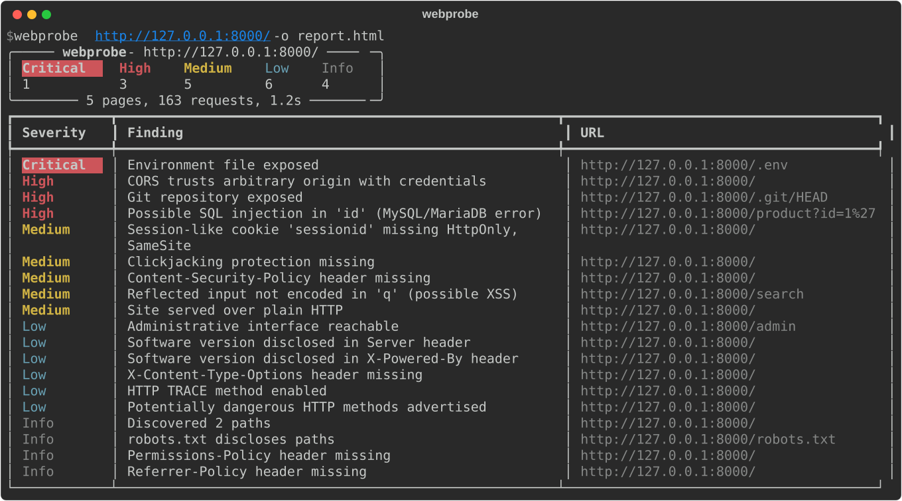

# webprobe


A modular, **non-destructive** web application security scanner written in Python
(async `httpx`, `rich` output). It ships with **ShopLab**, a deliberately vulnerable local
app you can practise on and that the test suite scans end-to-end.



**Sample output:** [Markdown report](docs/sample-report.md) · [HTML report](docs/sample-report.html) (download and open in a browser)

> **Legal:** only scan systems you own or have explicit written permission to test.
> Unauthorised scanning is illegal in most countries, even when the checks are harmless.

## Highlights

- **Async scanning engine:** `asyncio` + `httpx` with bounded concurrency and an optional rate limiter; 160+ requests in about a second against a local target.
- **Scope enforced at the HTTP layer:** every request is checked against the target origin, and off-host redirects abort the scan.
- **False-positive control built in:** soft-404 fingerprinting with text similarity, content-signature checks for exposed files, baseline diffing and balanced-quote confirmation for SQL errors, context-aware (HTML / attribute / script) analysis for reflected input.
- **Plugin-style checks:** each check is one small class; adding one means writing a class and adding it to the registry.
- **Tested end-to-end** against a purpose-built vulnerable app, including negative controls (a correctly escaped page and a soft-404 server must stay clean). CI runs on Python 3.10–3.14.
- **Reports for real engagements:** HTML (filterable by severity), Markdown for write-ups, JSON for pipelines, and `--fail-on` for CI gating.

## What it checks

| ID | Check | Highlights |
|---|---|---|
| `headers` | Security headers | CSP (missing / `unsafe-inline` / wildcard), clickjacking, HSTS, nosniff, version disclosure |
| `cookies` | Cookie attributes | Secure / HttpOnly / SameSite, stricter for session-like cookies |
| `tls` | TLS / HTTPS | Untrusted / expiring certs, TLS 1.0/1.1 support, weak ciphers, HTTP->HTTPS redirect |
| `exposed-files` | Sensitive files | `.git`, `.env`, backups, SQL dumps, SSH keys, phpinfo, actuator… **verified by content signature**, secrets redacted |
| `content-discovery` | Path enumeration | Wordlist + `robots.txt`, with soft-404 fingerprinting to suppress false positives |
| `cors` | CORS | Arbitrary origin reflection, `null` origin, prefix/suffix matching bypasses |
| `http-methods` | HTTP methods | Advertised risky methods, TRACE echo (never sends PUT/DELETE) |
| `reflected-input` | XSS indicator | Benign marker; checks which of `" ' < > `` survive unencoded and in which context |
| `sql-errors` | SQLi indicator | `'` probe vs baseline; a balanced `''` that clears the error confirms it |

"Non-destructive" means only GET/OPTIONS/TRACE requests, no form POSTs, crawling that
skips logout/delete links, and bodies capped at 512 KB (64 KB for file probes).

## Quick start

```bash
python -m venv .venv && source .venv/bin/activate
pip install -e ".[dev]"
```

Start the practice target in one terminal:

```bash
python -m lab.vulnapp --port 8000
```

Scan it from another:

```bash
webprobe http://127.0.0.1:8000/ -o report.html -o report.md
```

Without installing, `PYTHONPATH=src python -m webprobe …` works too.

## Usage

```text
webprobe TARGET [options]

  -c, --checks IDS        only run these checks (comma-separated)
  -x, --exclude IDS       skip these checks
  --list-checks           show all checks

  --no-crawl              only test the target URL
  --max-pages N / --depth N
  -w, --wordlist FILE     custom content-discovery wordlist

  -H 'Name: value'        extra header (repeatable), e.g. Authorization
  --cookie 'a=1; b=2'     authenticated scans
  --proxy URL             e.g. http://127.0.0.1:8080 to watch traffic in Burp/ZAP
  --rate-limit RPS        be gentle with fragile targets
  --concurrency N / --timeout SEC / --verify-tls

  -o FILE                 report: .html, .md or .json (repeatable)
  --min-severity LEVEL    hide findings below LEVEL
  --fail-on LEVEL         exit 1 if anything >= LEVEL (CI gate)
  -v                      full details in the terminal
```

Examples:

```bash
# authenticated scan through Burp, max 5 requests/second
webprobe https://staging.example.com/ --cookie "session=…" --proxy http://127.0.0.1:8080 --rate-limit 5

# CI gate: only care about medium and up, fail the build on high
webprobe https://staging.example.com/ --min-severity medium --fail-on high -o webprobe.json
```

Exit codes: `0` ok, `1` `--fail-on` threshold hit, `2` scan couldn't start, `130` interrupted.

## Architecture

```text
src/webprobe/
  cli.py            argument parsing, wiring, exit codes
  engine.py         resolve target -> not-found baseline -> crawl -> run checks concurrently -> collate
  client.py         HttpClient (origin scope, semaphore, rate limit, capped bodies) + NotFoundProfile
  crawler.py        same-origin BFS crawler: pages, parameterised links, forms
  context.py        ScanContext shared by checks, InjectionPoint enumeration
  checks/           one module per check; registry in checks/__init__.py
  console.py        rich terminal output
  reports.py        JSON / Markdown / HTML writers
  data/wordlist.txt default discovery wordlist
lab/vulnapp.py      ShopLab practice target (binds to 127.0.0.1 only)
tests/              unit tests + end-to-end scans of ShopLab
```

Design choices worth knowing:

- **Scope is enforced in the client.** Every request goes through `HttpClient.request`, which refuses
  to leave the target's scheme/host/port. If the target redirects to another host, the scan aborts.
- **Soft-404 fingerprinting.** Before discovery, the scanner requests random paths and records how
  the server answers (status, body similarity, redirect target). Hits that look like that baseline
  are dropped. If most of the wordlist still "exists", results are discarded as inconclusive.
- **Content signatures over status codes.** `exposed-files` only reports a file when its body
  matches what that file really looks like (e.g. `ref: refs/` for `.git/HEAD`).
- **One failing check never kills the scan.** Exceptions are recorded as scan warnings.

## Writing a new check

```python
# src/webprobe/checks/my_check.py
from webprobe.checks.base import Check
from webprobe.context import ScanContext
from webprobe.models import Finding, Severity

class MyCheck(Check):
    id = "my-check"
    name = "My check"
    description = "What it looks for."

    async def run(self, ctx: ScanContext) -> list[Finding]:
        response = await ctx.client.fetch("some/path")
        if response and response.status == 200 and b"marker" in response.content:
            return [self.finding("Something found", Severity.LOW, response.url, "Why it matters.",
                                 evidence="…", remediation="How to fix.")]
        return []
```

Then add `MyCheck` to `ALL_CHECKS` in `checks/__init__.py` and a test in `tests/`.

Useful things on `ctx`: `client` (`fetch`, `request`, `url`, `in_scope`), `homepage`, `crawl.pages`,
`crawl.forms`, `injection_points()`, `not_found.matches(response, path)`.

## Tests

```bash
pytest -q
```

The end-to-end tests start ShopLab on a random local port and assert that every planted issue is
found, that `/safe-search` (correctly escaped) is **not** flagged, that `/logout` is never crawled,
and that a soft-404 server produces no false positives.

## Limitations / ideas for next steps

- GET parameters only. POST forms, JSON bodies and headers as injection points would need an
  opt-in flag because submitting forms can change state.
- The XSS and SQLi checks are *indicators*. Confirm manually (or with Burp/sqlmap, if in scope).
- No JavaScript rendering, so SPA routes that exist only in JS aren't crawled.
- The TLS check connects directly, not through `--proxy`. TLS 1.0/1.1 detection depends on the
  local OpenSSL build being able to speak those versions.
- Ideas: GraphQL introspection check, open-redirect check, JWT analysis, subdomain takeover
  fingerprints, a SARIF report for GitHub code scanning.
